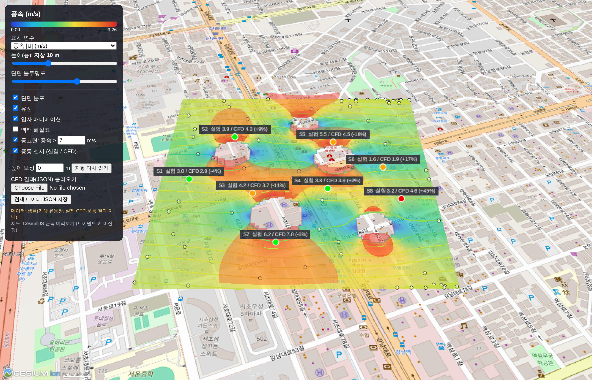

# CFD 풍환경 결과 – 브이월드 3D 가시화 데모

OpenFOAM 결과(U, k, p)를 높이별로 브이월드 3D 지도 위에 보여 주는 샘플입니다.



## 파일

| 파일 | 역할 |
|---|---|
| `vworld_cfd_demo.html` | 뷰어. 샘플 데이터가 들어 있어 바로 실행됩니다. |
| `openfoam_to_json.py` | OpenFOAM 케이스를 뷰어용 JSON 으로 바꾸는 변환기 |

## 실행

브라우저에서 파일을 직접 열면(file://) 지도가 그려지지 않습니다. 로컬 웹 서버로 여세요.

```
cd vworld_cfd
python -m http.server 8000
# 브라우저: http://localhost:8000/vworld_cfd_demo.html
```

- **브이월드 지도로 보기**: `vworld_cfd_demo.html` 위쪽의 `VWORLD_KEY` 에 인증키를 넣습니다. 키 발급 시 `localhost` 를 서비스 URL 로 등록해야 합니다.
- **키 없이 미리보기**: 키를 넣지 않으면 CesiumJS + OpenStreetMap 배경으로 실행됩니다. 주소 뒤에 `?standalone=1` 을 붙여도 같습니다.

## 화면 기능

| 항목 | 설명 | 쓰는 변수 |
|---|---|---|
| 표시 변수 | 풍속, 풍속비, 난류 강도, 돌풍 풍속, 압력계수 Cp 전환 | U, k, p |
| 높이(층) 슬라이더 | 층을 바꾸면 단면·유선·입자·화살표가 그 높이로 다시 그려짐 | – |
| 단면 분포 | 선택한 층의 컬러맵. 지상 2 m 이하 층은 지표에 붙여 표시 | 선택 변수 |
| 유선 / 입자 | 선택한 층에서 출발, w 성분까지 3차원 적분. 입자는 풍속에 비례해 이동(12배속) | U |
| 벡터 화살표 | 약 25 m 간격, 길이는 풍속에 비례 | U |
| 등고면 | 풍속이 입력값 이상인 영역의 경계면 (2층 이상 데이터 필요) | U |
| 풍동 센서 | 측정값과 같은 위치의 CFD 풍속 비교. 오차 10 % 이내 녹색, 25 % 이내 주황, 초과 빨강 | U |
| 높이 보정 / 지형 다시 읽기 | 결과가 땅에 묻히거나 떠 보일 때 사용 | – |

파생 변수 정의: 풍속비 = |U| / U_ref, σ = √(2k/3), 난류 강도 = σ / |U|, 돌풍 풍속 = |U| + 3.5σ, Cp = (p − p_ref) / (½ U_ref²).

## JSON 규격

```
{ "west":.., "south":.., "east":.., "north":..,    경위도(EPSG:4326)
  "nx":N, "ny":M, "nz":L,                           격자 수 (nz 생략 시 1층)
  "z":[1.5, 5, 10, ...],                            각 층의 지상 높이(m)
  "U_ref":5, "z_ref":10,                            기준 풍속과 그 높이
  "u":[..], "v":[..], "w":[..],                     m/s, 동/북/위. 길이 nx*ny*nz
  "k":[..],                                         (선택) 난류 운동에너지
  "p":[..], "p_ref":0, "p_unit":"kinematic",        (선택) 압력. kinematic = p/ρ, 또는 "Pa"
  "sensors":[{"name":"S1","lon":..,"lat":..,"z":1.5,"measured":4.2}] }
```

배열 순서는 층(아래→위) → 행(남→북) → 열(서→동) 이며 `index = (kz*ny + j)*nx + i` 입니다.
건물 내부처럼 값이 없는 점은 `null` 입니다. 초안의 2D 형식(nz, z, w 없음)도 그대로 읽습니다.
뷰어의 "현재 데이터 JSON 저장" 버튼으로 샘플을 내려받으면 실제 예시를 볼 수 있습니다.

## OpenFOAM 결과 변환

```
pip install pyvista
python openfoam_to_json.py ./myCase \
    --origin-lon 127.0276 --origin-lat 37.4979 --x-bearing 90 \
    --z 1.5 5 10 15 20 25 30 --nx 161 --ny 161 \
    --uref 5 --zref 10 --sensors windtunnel.csv --out cfd_field.json
```

- `--origin-lon/lat`: CFD 로컬 좌표 (0,0) 의 실제 경위도
- `--x-bearing`: CFD +x 축의 방위각(북=0, 시계방향). 90 이면 x=동, y=북
- `--time`: 읽을 시간 폴더. 생략하면 마지막 폴더(정상 해석의 수렴 결과)
- `--fields UMean kMean pMean`: 비정상 해석의 시간 평균 필드를 쓸 때
- `--sensors`: 풍동 CSV. 열은 `name,x,y,z,measured`(로컬 실척 m) 또는 `name,lon,lat,z,measured`

전제: 지면이 평평한 격자, 도메인 수 km 이내, 병렬 해석은 `reconstructPar` 후 사용.

## 한계

- 샘플 유동장은 원기둥 주위 포텐셜 유동을 흉내 낸 가상 값이며 실제 CFD·풍동 결과가 아닙니다.
- 브이월드 내부의 Cesium 뷰어(`ws3d.viewer`)에 접근하는 방식은 공식 문서에 없는 방법이라 API 버전이 바뀌면 수정이 필요할 수 있습니다.
- 압력은 공간 단면의 Cp 로만 표시합니다. 건물 외벽 풍압 표시는 포함되어 있지 않습니다.
